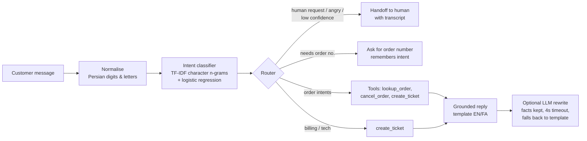
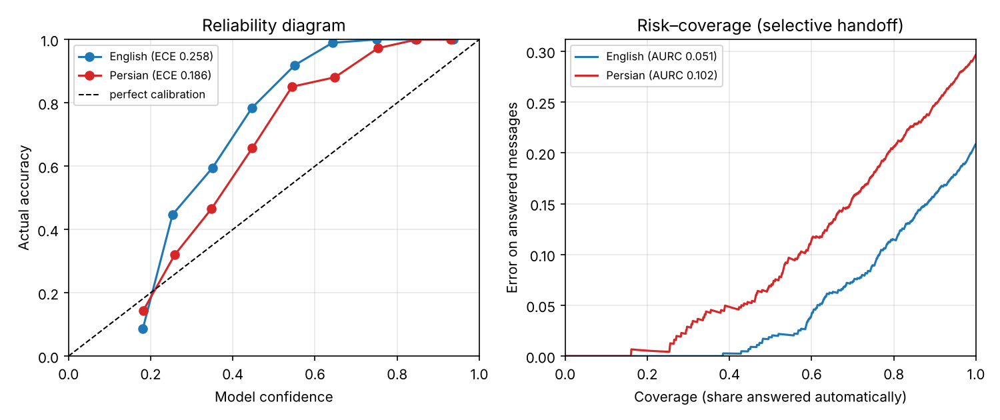

# Bilingual Customer-Support Agent (English / Persian)

**Confidence-based human handoff in English and Persian: a working agent, a classifier study, and an LLM confidence study**

A small, production-style support agent that reads customer chat messages in **English or Persian**,
detects what the customer wants, **calls back-office tools** (order lookup, cancellation, ticketing),
answers simple requests automatically, and **hands hard or sensitive cases to a human** with the full context.

It has two layers:

1. **Engineering:** a working agent with routing, tool use, safe fallbacks, an API and a chat UI, built to the
   standards that matter when AI runs in real operations (latency, reliability, measurable accuracy).
2. **Research:** a small, reproducible study asking whether an agent's *own confidence* is equally trustworthy
   in a lower-resource language (Persian) as in English when it decides to hand a customer to a human.
   → [Research question and findings](#research-is-confidence-based-handoff-fair-across-languages)

## How it works



- **8 intents:** order status, refund, cancel, change address, billing, technical problem, greeting, human agent.
- **Multi-turn:** if the customer says "where is my order?" the agent asks for the number and continues the same task.
- **Business rules:** shipped orders can't be cancelled; unknown order numbers go to a human.
- **Safety-first routing:** explicit human requests, angry messages and low-confidence predictions are escalated rather than guessed.
- **Optional LLM:** set `LLM_API_KEY` (any OpenAI-compatible endpoint) to make replies more natural. The LLM only rewrites a reply that is already grounded in tool results, so it cannot invent order data, and the agent keeps working if the LLM is slow or down.
- **Every response reports** intent, confidence, route, tools called and per-stage latency.

## Engineering results (held-out test set, CPU, no LLM)

| Metric | Value |
|---|---|
| Intent accuracy (30 held-out messages) | 100% (EN 100%, FA 100%) |
| Routing accuracy (auto vs. human handoff) | 100% |
| Latency per message, p50 / p95 | ~0.8 ms / ~0.9 ms |

The held-out set is small, so the more reliable numbers are the cross-validated ones in the research section
(74.8% overall). Full report: [`results/report.md`](results/report.md).

## Research: is confidence-based handoff fair across languages?

**Question.** Support agents usually answer automatically when their confidence is above a threshold and
hand off to a human otherwise. If confidence is less reliable in one language, one group of customers gets
more wrong automatic answers. Does a single threshold behave the same for English and Persian?

**Setup.** 190 messages (97 EN, 93 FA), 8 intents; stratified 5-fold cross-validation repeated over 10 seeds
(mean ± std). Metrics: accuracy, macro-F1, Expected Calibration Error (ECE), Brier score, risk–coverage
curves and AURC (selective prediction). Code: [`research/experiments.py`](research/experiments.py) ·
full report: [`results/research/research_report.md`](results/research/research_report.md).



**Findings**

1. **Same threshold, unequal errors.** At the deployed threshold (0.30) both languages get ~85% of messages
   answered automatically, but the auto-answers are wrong **13.2% of the time in English vs 22.7% in Persian**.
2. **ECE alone is misleading.** Persian has the *lower* ECE (0.186 vs 0.258) yet clearly worse selective
   performance (AURC 0.102 vs 0.051). The model is underconfident in both languages, and the lower Persian
   ECE mostly reflects lower accuracy, not more useful confidence. Risk–coverage is the metric that matches
   the handoff decision.
3. **Per-language thresholds restore parity at a cost.** Keeping auto-answer error ≤10% needs a threshold of
   ~0.35 for English but ~0.45 for Persian, which leaves **76.5% vs 57.6%** of messages handled automatically,
   so Persian speakers would wait for humans more often.
4. **Character n-grams beat word features** (74.8% vs 62.3%), consistent with Persian's rich morphology and
   spelling variation; this ablation is why the deployed model uses character features only. Persian
   normalisation made no measurable difference on this data.
5. **No cross-lingual transfer.** Training on one language and testing on the other is near chance
   (16–19% vs 12.5%), as expected for surface features across two scripts.
6. **Persian is more data-hungry.** The English–Persian gap stays at roughly 8–9 points along the learning curve.

### E7 · Does the same hold for a large language model?

[`research/llm_confidence.py`](research/llm_confidence.py) repeats the question with an LLM used zero-shot as the
intent classifier, using two kinds of confidence: **verbalised** (the model states 0–100 next to its answer) and
**consistency** (the share of k sampled answers that agree with the majority). For each language it reports
accuracy, ECE, AURC and what the 0.30 handoff threshold means, next to the classifier above. Unusable replies
count as wrong with confidence 0, and every response is cached so reruns are free.

```bash
export LLM_API_KEY=... LLM_BASE_URL=https://api.openai.com/v1 LLM_MODEL=gpt-4o-mini
python research/llm_confidence.py --samples 5     # -> results/research/llm_report.md
python research/llm_confidence.py --mock          # offline pipeline check, fake answers
```

Results for E7 are not included yet: they will be added once the study has been run on a real model.

**Limitations.** Small, author-written dataset; one model family; no real customer traffic. The results are
a pilot that motivates the questions below rather than a general claim.

**Next steps.** Run E7 on several LLMs, repeat the study with multilingual sentence embeddings, add
post-hoc calibration (temperature scaling) per language, and compare verbalised LLM confidence with
token-level probabilities. This connects to my broader interest in how reliable model uncertainty is in
lower-resource languages such as Persian, and in designing human-in-the-loop systems that stay fair when
that uncertainty differs across user groups.

## Run it

```bash
pip install -r requirements.txt
python data/build_data.py        # regenerate dataset (already included)
python eval.py                   # engineering metrics -> results/
python research/experiments.py   # research study (~20 s) -> results/research/
pytest -q                        # 12 tests
uvicorn app:app --reload         # chat UI at http://127.0.0.1:8000
# optional LLM:
export LLM_API_KEY=... LLM_BASE_URL=https://api.openai.com/v1 LLM_MODEL=gpt-4o-mini
```

API: `POST /chat {"session_id": "abc", "message": "سفارش ۱۰۲۳۴ کجاست؟"}`

Example response:

```json
{"reply": "سفارش 10567 لغو شد. مبلغ ظرف ۳ تا ۵ روز به کارت شما برمی‌گردد.",
 "intent": "cancel_order", "confidence": 0.941, "language": "fa", "route": "auto",
 "actions": [{"tool": "lookup_order", "order_id": "10567", "found": true}, {"tool": "cancel_order", "ok": true}],
 "latency_ms": {"classify": 2.7, "tools": 1.21, "respond": 0.0, "total": 3.92}}
```

Demo orders: `10234` (shipped), `10567` (processing, cancellable), `10891` (delivered).

## Structure

```
agent/
  text.py        Persian normalisation, language detection, order-ID extraction, anger cues
  classifier.py  bilingual intent classifier
  tools.py       mock order / ticket / handoff tools (swap for real APIs)
  responses.py   EN/FA reply templates
  llm.py         optional OpenAI-compatible rewrite layer with timeout + fallback
  router.py      the agent: classify -> route -> tools -> reply, with latency
app.py           FastAPI service + chat UI (static/index.html)
eval.py          engineering evaluation
research/        research experiments (ablation, calibration, selective handoff, transfer, learning curve, LLM confidence)
tests/           pytest suite
```

Author: Sahar Mirzabaki · [GitHub](https://github.com/SaharMb90)
