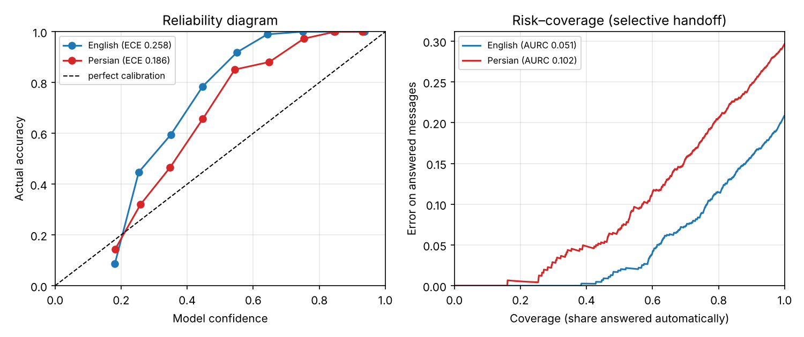
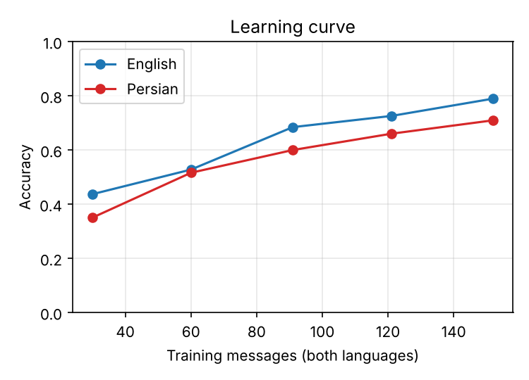

# Research report — confidence-based handoff across English and Persian

Data: 190 messages (97 English, 93 Persian), 8 intents. Protocol: stratified 5-fold CV repeated over 10 seeds; mean ± std across seeds. Handoff threshold = 0.3.

## E1 · Model ablation (accuracy %, macro-F1 %)

| Model | Accuracy | Macro-F1 | English | Persian |
|---|---|---|---|---|
| char · LogReg (deployed) | 74.8 ± 1.3 | 75.2 ± 1.3 | 79.2 ± 2.6 | 70.3 ± 2.2 |
| char+word · LogReg | 70.5 ± 1.9 | 70.9 ± 2.0 | 76.3 ± 2.9 | 64.4 ± 2.7 |
| word · LogReg | 62.3 ± 2.4 | 62.7 ± 2.4 | 65.1 ± 3.6 | 59.5 ± 2.8 |
| char+word · ComplementNB | 70.5 ± 1.4 | 70.5 ± 1.4 | 74.2 ± 2.5 | 66.6 ± 2.5 |
| char · LogReg · no Persian normalisation | 74.9 ± 1.5 | 75.3 ± 1.5 | 80.0 ± 2.7 | 69.6 ± 3.1 |

## E2–E3 · Calibration and selective handoff (deployed model)

| Metric | English | Persian |
|---|---|---|
| ECE (lower = better calibrated) | 0.258 ± 0.017 | 0.186 ± 0.027 |
| Brier score | 0.377 ± 0.016 | 0.438 ± 0.021 |
| AURC (lower = better ranking of its own errors) | 0.051 ± 0.009 | 0.102 ± 0.018 |
| Coverage at threshold 0.3 (% answered automatically) | 84.0 ± 2.1 | 85.4 ± 2.6 |
| Error on auto-answered messages at 0.3 (%) | 13.2 ± 2.8 | 22.7 ± 4.1 |

English − Persian accuracy gap across seeds: 8.9 ± 4.0 points.

## E4 · Cross-lingual transfer (accuracy %)

| Setting | Accuracy |
|---|---|
| train English → test Persian | 16.1 |
| train Persian → test English | 18.6 |
| chance (1/8) | 12.5 |

## E5 · Learning curve

| Training messages | English | Persian |
|---|---|---|
| 30 | 43.7 | 35.1 |
| 60 | 52.8 | 51.6 |
| 91 | 68.5 | 60.0 |
| 121 | 72.6 | 66.0 |
| 152 | 79.0 | 71.0 |

## E6 · Per-language thresholds for ≤10% error on auto-answered messages

| Language | Threshold needed | Coverage (% answered automatically) |
|---|---|---|
| English | 0.351 ± 0.037 | 76.5 ± 5.1 |
| Persian | 0.452 ± 0.071 | 57.6 ± 9.5 |
